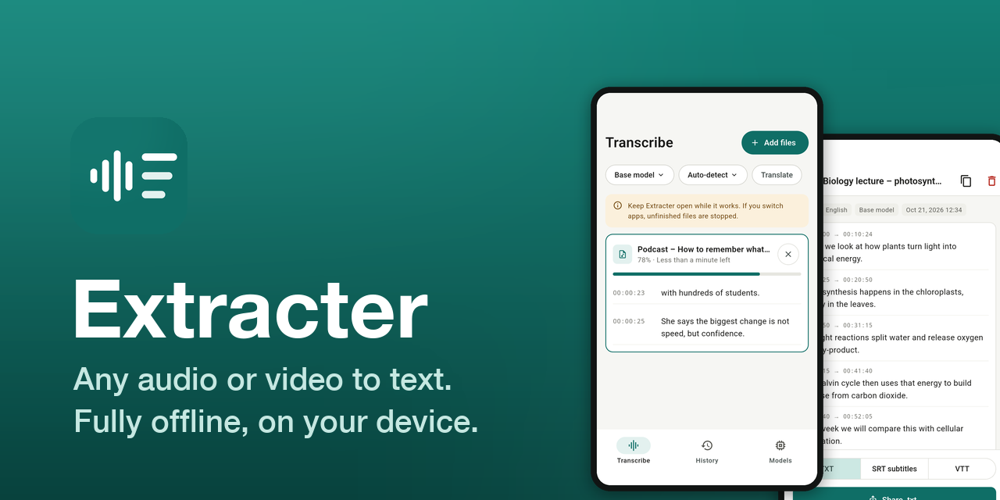
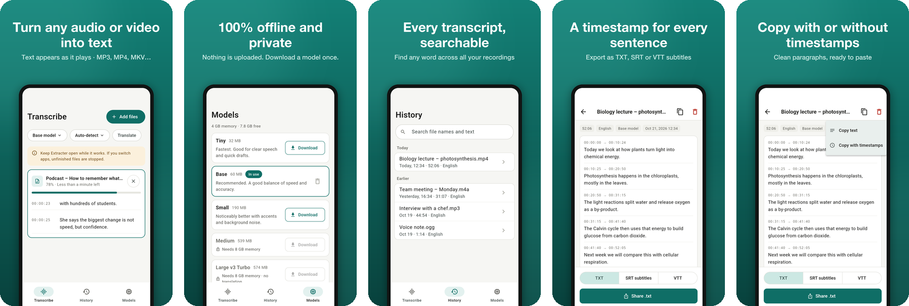
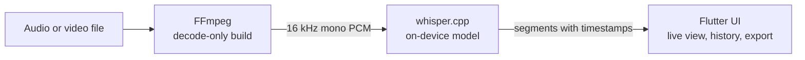

<p align="center">
  
</p>

<p align="center">
  <b>Turn any audio or video file into text, right on your device.</b><br>
  No uploads, no account, no subscription: speech recognition runs locally with Whisper.
</p>

<p align="center">
  
  
  
  
  
  <a href="LICENSE"></a>
</p>

<p align="center">
  <a href="#features">Features</a> ·
  <a href="#screenshots">Screenshots</a> ·
  <a href="#how-it-works">How it works</a> ·
  <a href="#models">Models</a> ·
  <a href="#privacy">Privacy</a> ·
  <a href="#build-from-source">Build</a>
</p>

---

## Features

|   |   |
|---|---|
| 🎧 **Any format** | MP3, M4A, WAV, OGG, OPUS, FLAC, AAC, MP4, MOV, MKV, WEBM, AVI and more. For video, the audio track is used automatically. |
| 🔒 **Offline and private** | Decoding and recognition happen on the device. Your files never leave it. |
| ⚡ **Live results** | Text appears segment by segment while the file is processed, with progress and time left. |
| 📚 **Batch queue** | Add many files at once, or drag and drop them on desktop. They run one after another. |
| 🌍 **About 100 languages** | Automatic language detection, plus optional translation of speech into English. |
| ⏱️ **Timestamps** | Every sentence keeps its start and end time. |
| 📋 **Copy two ways** | As clean paragraphs, or with `[00:00:12 → 00:00:18]` timestamps. |
| 💾 **Export** | TXT, SRT or VTT subtitles, shared anywhere. |
| 🔎 **Searchable history** | Full-text search across every transcript (SQLite FTS5). |
| 🗣️ **English and Russian UI** | Follows the system language. |

## Screenshots

<p align="center">
  
</p>

## How it works



- **Native engine.** A small C ABI (`packages/extracter_native`) runs each file on a native
  worker thread. FFmpeg decodes it, and whisper.cpp transcribes it in chunks of about three
  minutes, each cut at the quietest point near its end so sentences aren't split.
- **Hardware.** Metal and Accelerate on Apple devices, optimised CPU code elsewhere.
- **Dart side.** Events reach Dart through a native port, so a job stays safe even if the app
  is closed while it runs. Transcripts are stored in a local SQLite database.
- **Architecture.** Feature-first Flutter code with controllers, repositories and
  dependency-injected config widgets. See [PLAN.md](PLAN.md) for the full design.

## Models

Models are downloaded once, verified with SHA-256, and then used fully offline.

| Model | Size | Best for |
|---|---:|---|
| Tiny | 32 MB | Fastest; clear speech and quick drafts |
| **Base** | 60 MB | **Recommended**: good balance of speed and accuracy |
| Small | 190 MB | Better with accents and background noise |
| Medium | 539 MB | High accuracy; needs about 8 GB of memory |
| Large v3 Turbo | 574 MB | Most accurate; needs about 8 GB of memory |

## Privacy

Extracter collects no data: no analytics, no ads, no crash reporting and no accounts. The
only network request downloads a model from Hugging Face. Read the full
[privacy policy](https://sb-dor.github.io/extracter-privacy/).

## Build from source

```bash
git clone --recurse-submodules https://github.com/sb-dor/Extracter.git
```

```bash
cd Extracter && packages/extracter_native/scripts/build_apple.sh
```

```bash
flutter pub get && dart run intl_utils:generate && dart run build_runner build --delete-conflicting-outputs
```

```bash
flutter run -d macos
```

Android, Windows and Linux need FFmpeg built for that target first. Full instructions, tests
and release builds are in [docs/DEVELOPMENT.md](docs/DEVELOPMENT.md).

| Platform | Status |
|---|---|
| Android | Release build tested on the emulator; submitted to Google Play |
| iOS | Tested on the Simulator |
| macOS | Release build tested |
| Windows, Linux | Build scripts ready, not built yet |

## Third-party components

Extracter builds on [whisper.cpp](https://github.com/ggml-org/whisper.cpp) (MIT),
[FFmpeg](https://ffmpeg.org) (LGPL-2.1, dynamically linked, decode-only) and OpenAI's
[Whisper](https://github.com/openai/whisper) models (MIT). Exact versions, hashes and build
flags are listed in [THIRD_PARTY.md](THIRD_PARTY.md).

## License

Extracter's own code is released under the [MIT License](LICENSE). Third-party components
keep their own licenses, listed above.
